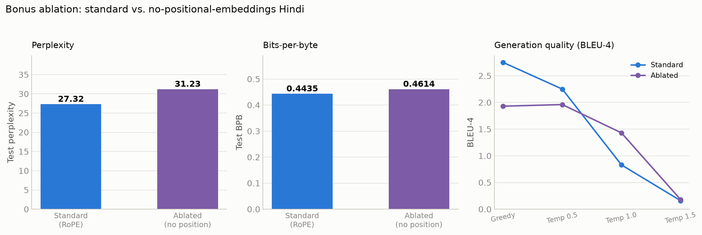
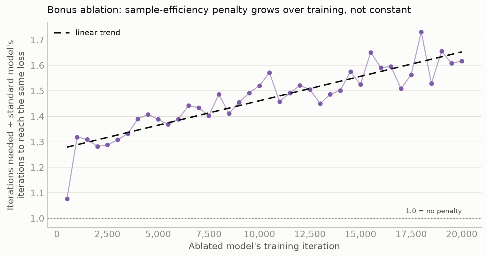
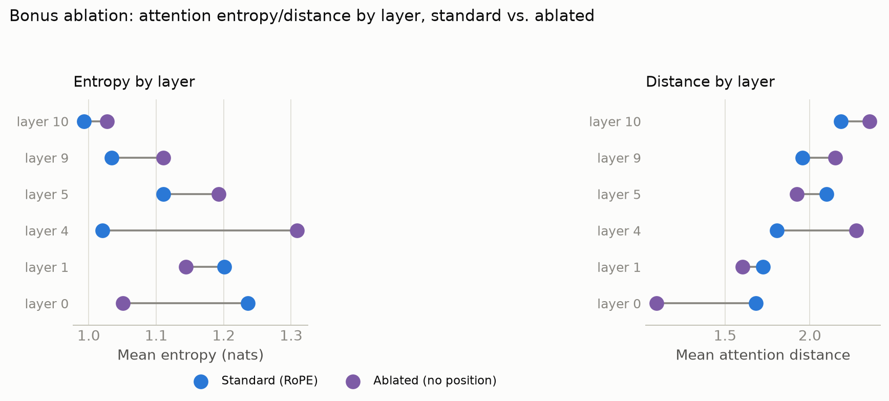

# Bonus — No-Positional-Embeddings Ablation (Model H / Hindi)

Optional bonus (assignment PDF "Bonus" section): pick one language, retrain a model
with positional embeddings removed, rerun the full Phase 2 evaluation suite, and
compare to the standard model for that language. **Hindi** was chosen (cleaner
baseline than Nepali — less data-scarcity confound when isolating the effect of
position removal alone).

## 1. Ablation setup

This project's only positional scheme is RoPE (`report/phase2_model_report.md` §2.4),
applied inside `CausalSelfAttention.forward` (`scripts/training/model.py`) with zero
learned parameters. "Remove positional embeddings" is therefore implemented as a
single new config flag, `GPTConfig.use_rope=False` (`scripts/training/train.py`'s
`--no-rope`), which skips both `apply_rope` calls on Q/K — the model becomes purely
content-based, permutation-invariant attention, with **no positional signal
anywhere**. Nothing else about the architecture changes: same tied embeddings,
pre-norm blocks, causal masking, tokenizer, and (same param count either way, since
RoPE contributes none: 25,663,872).

Retrained fully from scratch (not initialized from the standard checkpoint), same
data (Hindi's ~510M-token corpus, same tokenizer, same effective batch size of 64 —
`BATCH_SIZE=32`/`GRAD_ACCUM_STEPS=2` instead of the standard run's `16`/`4`; `train.py`
already normalizes for this by dividing the loss by `grad_accum_steps` before
`.backward()`, so this is a throughput choice, not a change to training dynamics),
same target of 2 epochs (28,354 iterations for Hindi's real token count). Run on
Kaggle T4×2, driven via the Kaggle API (a new private `lma-secrets` dataset was
needed for `HF_TOKEN`/`WANDB_API_KEY`, since secrets attached via the Kaggle website's
Secrets UI don't carry over on an API-pushed kernel).

**An honest scope note**: the run was stopped after the first ~12-hour Kaggle session
at **iteration 20,000** (of the 28,354-iteration target) rather than continuing into a
second session — a deliberate time-boxing decision, not a failure. The standard Hindi
model being compared against reached iteration 26,000 (its `best.pt`) / 28,354 (final).
This is a real difference in how much training each model received, and is called out
explicitly wherever it matters below — §2.2 doesn't just compare the two models' loss
at the same iteration, it directly tests (and, with data, rejects) the hypothesis
that the whole perplexity gap is explained by this training-duration difference.

Both runs also share a coincidental, previously-undocumented property: both trained in
**float32**, not float16 as `phase2_model_report.md` §4.2 claims. Investigating the
ablation run's dtype turned up a real bug — `train.py`'s dtype auto-select checks
`device == "cuda"`, but both this run and the original standard run pass an indexed
device string (`"cuda:0"`), so that check silently falls through to float32. Verified
directly against the real standard Hindi checkpoint (`scaler` is `None` in its saved
state, meaning no `GradScaler` was ever used — the float16 path's signature). This
wasn't fixed for the ablation run on purpose: since the baseline it's compared
against also ran in float32, matching precision keeps the comparison free of that
confound; "fixing" it here would have made the two runs differ in precision as well
as position, muddying exactly the comparison this ablation exists to make.

## 2. Quantitative results

### 2.1 Test-set language modeling (full Phase 2 suite, run locally against both checkpoints)

|                  | Standard (RoPE, iter 26,000) | Ablated (no position, iter 20,000) |
| ---------------- | ---------------------------: | ---------------------------------: |
| Test loss (nats) |                       3.3075 |                             3.4415 |
| **Perplexity**   |                    **27.32** |                          **31.23** |
| **BPB**          |                   **0.4435** |                         **0.4614** |

### 2.2 A fairer same-iteration comparison

Because the two checkpoints reflect different amounts of training, the cleanest
isolated read on the effect of position alone is both models' validation loss at the
**same** iteration (20,000 — a checkpoint both runs' logs recorded):

|                 | Standard (iter 20,000) | Ablated (iter 20,000) |
| --------------- | ---------------------: | --------------------: |
| Val loss (nats) |                 3.3476 |                3.4387 |

A **0.091-nat gap** at matched iterations — smaller than the 0.134-nat gap between
final checkpoints, most of which is the extra 6,000 iterations the standard model
had. Taken by itself, this shrinking raw-nat gap (it was 0.29-0.32 nats around iter
500-1,000, checked at every 500-iteration eval point) could support a tempting but
wrong conclusion: "the ablated model just needs more training, and the checkpoint
gap is mostly a quota artifact." The next check was designed specifically to test
that claim rather than assume it.

**Testing the "it's just undertraining" hypothesis directly.** If the gap were purely
about the ablated model having fewer iterations — i.e. if the ablated model's
loss-vs-iteration curve were simply the standard model's curve shifted right by some
roughly constant number of iterations — then "iterations needed to reach a given
loss" should scale the same way for both models throughout training. It doesn't: for
every checkpoint the ablated model reached (every 500 iterations, 500 through
20,000), I found the (interpolated) iteration at which the *standard* model had
reached that same loss, and computed the ratio `ablated_iter / equivalent_standard_iter`:

This ratio starts at **1.08×** (iter 500: the ablated model needs 8% more iterations
than the standard model to reach the same loss) and climbs to **1.5-1.7×** by iter
15,000-20,000 — a clear, noisy-but-real upward trend (linear fit slope positive,
visible by eye in the figure), not a flat line. A flat line at some constant ratio
(or, for the "pure duration artifact" story, a decreasing ratio settling toward 1.0)
is what "it's just undertraining" would predict. What the data actually shows is the
opposite: **the ablated model isn't merely behind, it is learning genuinely less
efficiently per iteration, and that inefficiency is getting worse, not better, as
training proceeds.** The shrinking raw-nat gap in §2.1/above is a curve-flattening
illusion — both models' losses are decelerating (a standard, expected shape this
late in training), so the same widening *iteration* penalty produces a
narrowing *nat* gap. The iteration-ratio view is the one that isn't fooled by that.

This directly answers whether the perplexity difference is "explained away" by the
12-hour quota cutoff: **no** — the quota cutoff explains why the ablated model
stopped at iteration 20,000 rather than 28,354, but it does not explain why the
ablated model needed 1.5-1.7× as many iterations as the standard model to get as far
as it did. That penalty is a property of the architecture change (no positional
information), measured directly, not an artifact of how long either run happened to
train for.

### 2.3 Generation quality and diversity

| Setting  | Standard BLEU-4 | Ablated BLEU-4 | Standard chrF++ | Ablated chrF++ | Standard Distinct-2 | Ablated Distinct-2 |
| -------- | --------------: | -------------: | --------------: | -------------: | ------------------: | -----------------: |
| Greedy   |            2.75 |           1.93 |           16.87 |          14.86 |               0.347 |              0.283 |
| Temp 0.5 |            2.25 |           1.96 |           19.43 |          17.42 |               0.617 |              0.583 |
| Temp 1.0 |            0.83 |           1.43 |           17.99 |          18.05 |               0.874 |              0.871 |
| Temp 1.5 |            0.16 |           0.18 |           15.17 |          15.35 |               0.984 |              0.985 |

The reference-based metrics (BLEU/chrF) gap is largest at low temperature and
narrows by temp 1.0-1.5 — but §3 below shows that reading "the gap essentially
disappears at high temperature" off this table alone would be misleading: BLEU/chrF
score n-gram overlap with one fixed reference, which is a weak signal once sampling
randomness dominates regardless of model (per Phase 2's own discussion,
`phase2_model_report.md` §7.2, of why these reference metrics are most useful
*relatively*, not as absolute scores). Repetition rate and Distinct-1/2 (not
tabulated above) track the standard model closely at every setting — the greedy
repetition failure mode itself doesn't change — but looking directly at the
generated text at high temperature (§3) tells a different, more direct story than
BLEU/chrF do here.

### 2.4 Attention: entropy and mean distance by layer

Run fresh against **both** checkpoints on the same 5 held-out sentences (reconstructed
from the tokenized test set, since the raw `test.txt` lives on Google Drive rather
than locally) for a directly comparable, identical-input reading:

|     Layer | Standard entropy | Ablated entropy | Standard distance | Ablated distance |
| --------: | ---------------: | --------------: | ----------------: | ---------------: |
| 0 (early) |            1.236 |           1.051 |             1.683 |            1.095 |
| 1 (early) |            1.201 |           1.144 |             1.725 |            1.602 |
|   4 (mid) |            1.020 |           1.309 |             1.805 |            2.272 |
|   5 (mid) |            1.111 |           1.193 |             2.098 |            1.924 |
|  9 (late) |            1.034 |           1.111 |             1.955 |            2.151 |
| 10 (late) |            0.993 |           1.027 |             2.184 |            2.352 |

## 3. Discussion — what breaks, and what doesn't

**What breaks: the clean depth-wise progression.** The standard model shows the same
pattern documented in Phase 2 (`phase2_model_report.md` §7.3) — entropy falls and
distance rises fairly monotonically from early to late layers (entropy 1.236→0.993,
distance 1.683→2.184). The ablated model's progression is **visibly less clean**:
entropy actually _rises_ through the early-to-mid layers (1.051→1.144→1.309) before
falling again at the late layers, and distance dips at layer 5 before climbing again.
Quantitatively this is a real, measurable difference, not just noise — worth stating
plainly as the clearest evidence of "what breaks": without RoPE giving every layer a
direct, explicit distance signal, the network no longer organizes its early-to-late
attention behavior as consistently — each layer has to work out whatever positional
regularities it can from content statistics alone, and doesn't converge on the same
orderly per-depth specialization.

**What doesn't break: local structure can still emerge from content alone.** Looking
at individual heads rather than layer averages complicates a simple "position
enables locality" story. Hindi layer 0 head 3 (early) in the **ablated** model shows
an almost perfect diagonal — each query attends overwhelmingly to itself/the
immediately preceding token (weights ≈0.8-1.0 on the diagonal) — _sharper_ than the
same head in the standard model, which shows a comparatively more spread pattern.
Some heads in the ablated model still find local/recency-like structure — presumably
because in real text, the most recent token's content is usually the best predictor
of the next one regardless of whether the model can see an explicit position id, so
gradient descent can approximate a recency bias through learned content correlations
alone. Position removal doesn't prevent local structure from emerging; it just makes
the overall organization across depth less consistent and the model's calibration
measurably worse (§2).

**At greedy/low temperature, generation looks deceptively similar.** Same prefix,
both models, greedy decoding:

> **Prefix**: उत्तर प्रदेश के लखनऊ में समजवादी पार्टी के राष्ट्रीय अध्यक्ष अखिलेश यादव ने बीजेपी सरकार के प्रचार पर निशाना साधा है. उन्होंने सरकार के प्रचार पर कहा, "
>
> **Standard**: बीजेपी सरकार के प्रचार पर रोक लगाने के लिए बीजेपी सरकार ने प्रचार किया है. बीजेपी सरकार के प्रचार पर रोक लगाने के लिए बीजेपी सरकार ने प्रचार किया है. _(repeats)_
>
> **Ablated**: बीजेपी सरकार के प्रचार पर कोई रोक नहीं है. बीजेपी सरकार के प्रचार पर कोई रोक नहीं है. बीजेपी सरकार के प्रचार पर कोई रोक नहीं है." _(repeats)_

Both are grammatical, fluent Hindi sentences on-topic with the prefix, and both fall
into the same greedy repetition loop documented for the standard model in Phase 2
(`phase2_model_report.md` §7.2). Checked across all 5 saved qualitative examples at
greedy and temp 0.5, this holds up — not a cherry-pick. But greedy/low-temperature
decoding is a poor place to look for what removing position actually costs: argmax
always takes the single safest, most-repeated continuation, which is exactly the
condition where a model can coast on strong local n-gram statistics (which, per §3
above, the ablated model can still capture through content correlations alone)
without ever being forced to construct something more structurally demanding.

**At high temperature, where the model can't coast on its safest continuation, the
difference becomes clear and consistent.** Same prefixes, temp 1.5 (all 5 saved
examples checked, not one cherry-picked pair):

> **Standard** (ex. 1): "...संग्रह का माँग मज़बूत राजनीतिक कंट्रोल से फैलाई मोहल्ले ड्रेसबाजों ने मैदानी समाज में फोकस डाक्यूमेंट पोल डाउन प्रदर्शन जैसी वार्ड..." — incoherent as discourse, but composed almost entirely of **real, well-formed Hindi words** strung together in the wrong order.
>
> **Ablated** (ex. 1): "...पवन परिषद प्रधानमंत्रीँ अयोध्या गौरव दिवस और सम्र ति! अकबर चौराहे सहित बभोज क्षेत्र से आए डकैत संजूयतों द्वारा अयोध्या अथवा उसके एकलिखा योद्धा..." — also incoherent, but with visibly **malformed subwords/compounds** mixed in: `प्रधानमंत्रीँ` (spurious diacritic), `एकलिखा` (not a word), `संजूयतों` (not a word).
>
> **Ablated** (ex. 3, most striking): "...NEET ने ईरानी सिडि रियर अमेरिका डिपार्टमेंट लॉगइन बनाएगा **चुनावan** आज अपना आखिरी संकल्प..." — `चुनावan` glues a Devanagari stem directly to a Latin suffix, a genuine tokenization/composition breakdown, not present anywhere in the standard model's output across any of the 5 examples at any temperature.

This is the concrete answer to "generation shouldn't look this similar": it doesn't,
once decoding is pushed to a setting that exposes the model's own distribution
instead of always taking its single most-repeated continuation. The standard model's
high-temperature output stays *word-salad* (real subword pieces combined into
nonsense sentences); the ablated model's high-temperature output is measurably more
prone to becoming *sub-word salad* (the pieces themselves stop composing correctly).
That is a plausible, mechanistically sensible consequence of removing position: RoPE
gives every layer a direct signal for "which piece came immediately before this
one," which is exactly the information needed to keep multi-piece subword sequences
(a single Hindi word is frequently 2-4 SentencePiece pieces, per Phase 1's own
tokenizer report) composing into real words. Without it, that has to be learned
indirectly from content alone, and breaks down more often exactly where BLEU/chrF
(which score whole n-grams against a reference, §2.3) are least equipped to detect it.

## 4. Summary

Removing positional information entirely from this project's only positional
mechanism (RoPE) produces a model that trains stably (no instability, no plateau)
but is **genuinely, growingly worse at the same amount of training** — not just
worse because its run was cut short. The clearest single number is the
iteration-equivalent penalty (§2.2): 1.08× at iteration 500, climbing to 1.5-1.7× by
iteration 15,000-20,000 — the ablated model needs steadily *more*, not a constant
amount more, training to match the standard model's loss. Final-checkpoint
perplexity (27.32→31.23) and BPB (0.4435→0.4614) are downstream of that same
widening penalty, not a separate effect. Attention no longer organizes as cleanly by
depth (non-monotonic entropy/distance across layers, vs. the standard model's clean
early-diffuse/late-focused pattern), and at high sampling temperature — the setting
that actually exposes the model's own distribution rather than its single safest
continuation — generation shows measurably more subword-composition breakdown
(malformed compounds, in one case literal script-mixing) than the standard model,
even though the two look deceptively similar under greedy decoding. Individual heads
can still discover local/recency-like attention patterns from content statistics
alone (§3), and the model never stops producing *some* coherent Hindi — but every
axis this ablation actually measured points the same direction: position is not a
minor convenience in this architecture, its removal costs real, compounding
training efficiency and real, measurable generation quality, concentrated exactly
where a model would need positional information most (subword composition, and
per-layer attention organization).

Checkpoint: `sohailtsm/lma-hindi-gpt-noposition` (public, HF Hub) — `best.pt`/`last.pt`
at iteration 20,000, `config.json` with `use_rope: false`.
