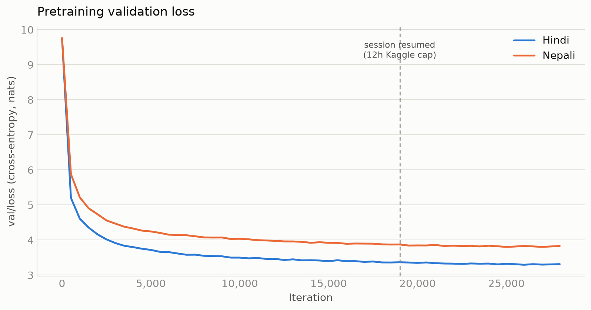
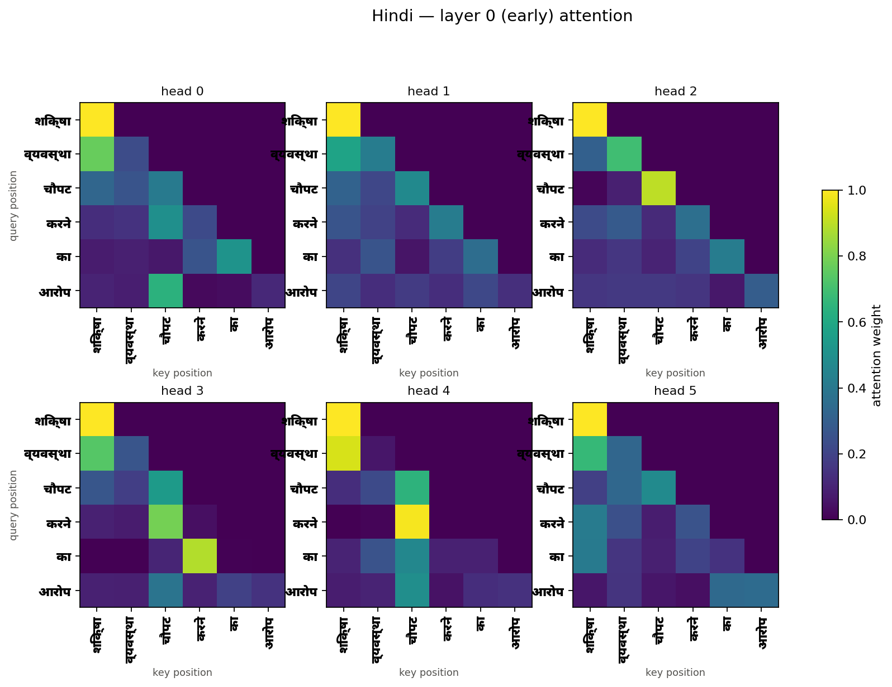
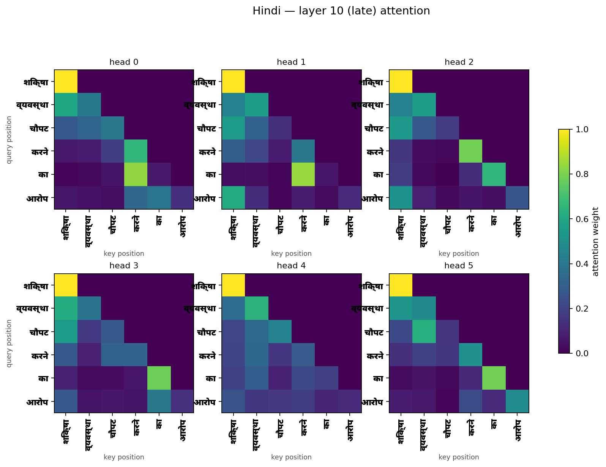

# Phase 2 — Model Architecture Report

Model H = Hindi. Model L = Nepali. Both use the **identical architecture** below, trained
independently with separate weights — since both languages share the same 16,000-token
vocab size (Phase 1, §6.1), the two models are parameter-for-parameter identical in shape,
which keeps the eventual H vs. L comparison a comparison of data/training, not of model
capacity.

This report covers the architecture/configuration decision (§1-§2), the pretraining data
pipeline and training procedure (§3-§4), the training infrastructure used to actually run
it (§5), and the pretraining run's own results (§6). Evaluation and attention analysis are
separate, later deliverables of Phase 2.

## 1. Chosen configuration

| Hyperparameter                 | Value                                                      |
| ------------------------------ | ---------------------------------------------------------- |
| Vocab size                     | 16,000 (per language, from Phase 1)                        |
| `d_model`                      | 384                                                        |
| `n_layers`                     | 11                                                         |
| `n_heads`                      | 6 (`d_k` = 64)                                             |
| `d_ff`                         | 1,536 (= 4 × `d_model`)                                    |
| Context length (`T`)           | 512                                                        |
| Positional encoding            | RoPE (Rotary Position Embeddings, applied to Q/K per head) |
| Input/output embedding         | Tied                                                       |
| Norm placement                 | Pre-norm (LayerNorm before each sublayer)                  |
| Dropout                        | 0.1                                                        |
| **Total trainable parameters** | **25,663,872**                                             |

Full parameter breakdown (embedding, per-block attention/FFN/LayerNorm costs, output head)
is in [`architecture_grid_search.md`](architecture_grid_search.md); the same tied-embedding,
`d_ff = 4·d_model` formula is used throughout. RoPE, like sinusoidal encoding, contributes
**zero** learned parameters, so switching to it (§2.4) doesn't change any of that grid's
parameter counts.

## 2. Rationale

### 2.1 Starting point, and a parameter-budget problem found along the way

The first candidate config paired with Phase 1's original 32,000-vocab tokenizer was
`d_model=384, n_layers=7` (24,710,016 params). Checking where those parameters actually
went surfaced a real issue: the **tied embedding table alone was 49.7%** of the entire
model — at `d_model=384`, a 32k vocab is disproportionately large relative to the
transformer body. For comparison, GPT-2-small (tied embeddings, `d_model=768`) sits at
31.0%; EleutherAI's Pythia-70M (`d_model=512`, untied) sits at 73.1% — the pattern holds
generally that embedding share is driven by `d_model`, not parameter count, and ours was
high because `d_model` was small relative to vocab.

### 2.2 Revising the tokenizer vocab to 16,000

This is documented in full in the Phase 1 report (§6.1): the fertility/UNK sweep alone
favored keeping 32,000 (it sits past the diminishing-returns elbow), but weighed against
the parameter-budget finding above, 16,000 was chosen instead — a modest, quantified
fertility cost (Hindi +0.050, Nepali +0.094 tokens/word) traded for cutting the tied
embedding table roughly in half. The tokenizer was retrained on the full 1M-sentence
sample at 16k and is the tokenizer both Model H and Model L actually use.

### 2.3 Choosing `d_model` and `n_layers`

With vocab fixed at 16,000, a 3×3 grid over `vocab_size × d_model` (8k/16k/24k ×
384/512/768), solving for the `n_layers` closest to 25M parameters at each combination,
is in [`architecture_grid_search.md`](architecture_grid_search.md). The relevant finding:
**as `d_model` grows, the number of layers that fits in a 25M budget collapses fast**
(block cost scales as `12·d_model²`, quadratic, while the embedding only scales linearly)
— at `d_model=768` the budget only fits 1-2 layers, which is barely a "deep" network at
all and mostly just an embedding table.

Literature research (also in `architecture_grid_search.md`) supports resolving this in
favor of depth:

- **Kaplan et al. 2020** ("Scaling Laws for Neural Language Models",
  [arXiv:2001.08361](https://arxiv.org/abs/2001.08361)) found Transformer loss depends
  very weakly on shape (`n_layer`, `d_model`, `n_heads`) at fixed total parameter count —
  they tested `d_model/n_layer` ratios from 33 to 715 within 3% loss of each other. Shape
  is a low-stakes choice at any fixed budget, including ours.
- **Levine et al. 2020** ("The Depth-to-Width Interplay in Self-Attention",
  [arXiv:2006.12467](https://arxiv.org/abs/2006.12467)) argue GPT-3 models up to ~13B were
  _already too shallow_ for their size — their computed optimum for a 125M-param model is
  23 layers, deeper than GPT-3-Small's actual 12.
- **Tay et al. 2021** ("Scale Efficiently", [arXiv:2109.10686](https://arxiv.org/abs/2109.10686))
  recommend increasing depth before any other scaling knob, with returns only flattening
  past 32-36 layers — far more than anything in this project's budget.

`d_model=384, n_layers=11` was chosen as the config that keeps the most depth (11 of the
9 grid rows, only `8,000/384/12` has more) while landing within 3% of the 25M target and
keeping embedding share at a healthy 23.9% — closer to reference small-LM norms
(GPT-2-small 31.0%, GPT-Neo-125M ~31%) than any `d_model=512` or `768` alternative at this
vocab size. Its `d_model/n_layers` ratio (34.9) is nearly identical to GPT-2-XL's own
shipped ratio (33.3), so it also isn't an outlier against real precedent, just on the
narrower/deeper side of the wide band Kaplan et al. showed is roughly equivalent.

### 2.4 Positional encoding: RoPE, and why not the alternatives

The assignment allows learned absolute embeddings, sinusoidal encoding, or a relative
scheme such as RoPE, and asks the choice to be justified and its constraint on maximum
sequence length explained. **RoPE (Rotary Position Embeddings, Su et al. 2021,
"RoFormer", [arXiv:2104.09864](https://arxiv.org/abs/2104.09864))** was chosen.

**How it works, briefly:** sinusoidal and learned absolute both add a position vector to
the token embedding at the input, once, before the first layer. RoPE does something
different: inside attention, it rotates the query and key vectors by an angle based on
token position, before they're compared to compute attention scores. The result: the
attention score between two tokens ends up depending only on the _distance_ between them,
not where they sit in absolute terms. Like sinusoidal, the rotation angle comes from a
fixed formula, not learned weights — **zero extra parameters**, so it doesn't touch the
parameter budget or the grid search in §2.3. It's also the positional method used by
essentially every current open-weight LLM (LLaMA, GPT-NeoX, PaLM, Mistral, Qwen).

**Effect on maximum sequence length:** a learned absolute table has a hard limit built
in — there's no row for position 513 if it only has 512 rows, so the model simply cannot
run on a longer input. RoPE has no table to run out of rows on; its rotation angle is
just computed from the position number, for any position. So the architecture itself
doesn't cap sequence length the way learned absolute does. In practice, this project
always trains and runs at a fixed `T=512`, so that extra headroom is never actually used
here — but it's a real difference in what the two schemes allow.

**Why not sinusoidal:** sinusoidal only adds a position signal once, at the input, before
any attention happens. Every layer after that has to work out relative distances between
tokens indirectly, from whatever of that original signal survives being carried through
the network. RoPE instead applies the position signal directly inside the attention
computation, at every layer — so every layer gets the actual distance between two tokens
directly, not something it has to infer. That's the real reason to prefer RoPE: a more
direct, per-layer positional signal, not a parameter-count or cost reason (both are free).

**Why not learned absolute embeddings:** the hard cap explained above — a fixed-size
position table with no row past `T_max` — is the reason. RoPE gives at least as good
positional information with no such table and no such cap, so there's no upside to
learned absolute here that would justify accepting that limitation.

### 2.5 Other fixed choices

- **Tied input/output embedding** — at this scale the embedding table is a large fraction
  of the model regardless of vocab choice; an untied output head would cost another
  6,144,000 parameters (another full embedding table's worth) for a transform already
  learned once.
- **Pre-norm placement** — more stable gradient flow through an 11-deep residual stack
  than post-norm, which is the standard reason pre-norm is preferred for deeper networks.
- **Context length 512** — a fixed choice independent of parameter count (RoPE, like
  sinusoidal, contributes 0 params regardless of `T`); balances usable context against the
  quadratic cost of attention on modest compute (Colab-tier GPU).

## 3. Data pipeline for pretraining

### 3.1 Tokenized binary format

`scripts/training/prepare_bin.py` tokenizes each of `train.txt`/`val.txt`/`test.txt` once
into a flat `uint16` array of token ids (`{split}.bin`), documents joined end to end by
the tokenizer's `<eos>` id (3) — no `<bos>` is inserted, since a single boundary marker is
enough to separate documents and matches standard GPT-style pretraining corpora (e.g.
GPT-2, nanoGPT). `uint16` rather than the more common `int32`/`int64` halves storage,
since vocab=16,000 fits comfortably under 65,536. Real measured token counts (per
`tokenized_meta.json`):

| Split |       Hindi |      Nepali |
| ----- | ----------: | ----------: |
| train | 464,565,873 | 461,871,393 |
| val   |  12,242,655 |  12,139,620 |
| test  |  12,262,365 |  12,146,825 |

At training time, `scripts/training/dataset.py` memory-maps this flat file rather than
loading it into RAM — this is what makes working with a ~930M-token file (per language)
practical on a machine (or Kaggle instance) with far less RAM than that.

### 3.2 Batch sampling: random windows, and what "epoch" means here

Each training example is a contiguous `block_size`-length window read starting at a
**uniformly random offset**, drawn fresh with `torch.randint` on every single call to
`get_batch` — not a shuffled pass through fixed, non-overlapping chunks. This is the same
approach nanoGPT's reference `get_batch` uses, and this project's `train.py`/`dataset.py`
follow that convention directly.

The consequence worth being explicit about: `--max-iters` is sized so that, **in
expectation**, every token position is included in some training window `EPOCHS` times —

```
tokens_per_iter = batch_size · grad_accum_steps · block_size
max_iters = floor(train_tokens · EPOCHS / tokens_per_iter)
```

(EPOCHS=2 in the actual runs) — but because sampling is independent and random rather
than a tracked, non-repeating pass, actual per-token coverage follows a Poisson-like
spread around that mean of 2, not a flat "every token seen exactly twice." Under that
approximation, roughly `e⁻² ≈ 13.5%` of each corpus is expected to be **never** sampled at
`EPOCHS=2`, while other stretches are sampled 3-4+ times by chance.

This is a known, deliberate simplification, not an oversight — it's the same tradeoff
nanoGPT itself makes. The alternative, used by Megatron-LM/GPT-NeoX (the lineage Pythia is
trained with), precomputes a document index repeated `E` times and shuffled once, then
walks it sequentially — guaranteeing exact per-epoch coverage, at the cost of an upfront
index-build step their own docs note "can take several minutes" before training starts.
At this project's scale (a few hundred million tokens, a couple of epochs, a from-scratch
course project on borrowed Kaggle GPU time), the simpler random-sampling approach was kept
rather than building that indexing machinery — the assignment's constraints favored
engineering time spent elsewhere.

## 4. Training procedure

### 4.1 Objective and masking

Standard next-token cross-entropy, computed in `model.py`'s `forward` as the mean over
every token position in the batch, comparing predicted next-token logits against the
input sequence shifted by one (`targets`, produced by `get_batch`). Attention is
**causally masked multi-head self-attention** — `F.scaled_dot_product_attention(...,
is_causal=True)` in `CausalSelfAttention.forward` — so every position only attends to
itself and earlier positions, never later ones; this is what makes the model an
autoregressive decoder rather than a bidirectional (BERT-style) encoder, consistent with
the assignment's decoder-only requirement.

### 4.2 Optimizer, learning-rate schedule, gradient clipping

- **AdamW**, with weight decay applied only to parameters with `dim() >= 2` (attention/FFN
  weight matrices, the tied embedding) and none to biases or LayerNorm parameters — the
  standard GPT-style split (nanoGPT, GPT-2 follow the same rule), since decaying
  1-dimensional scale/shift parameters has little regularizing benefit and can hurt
  optimization.
- **Linear warmup (300 iters) + cosine decay** to a `min_lr` floor — avoids the
  instability of starting training at full learning rate, standard for Transformer
  pretraining.
- **Global gradient-norm clipping at 1.0** — guards against rare gradient spikes
  destabilizing training, a standard, low-cost safeguard.
- **Mixed precision, chosen automatically per device**: `bfloat16` if the GPU supports it
  (`torch.cuda.is_bf16_supported()`), else `float16` with a `GradScaler`, else plain
  `float32` on CPU. Kaggle's T4 (Turing architecture) doesn't support `bfloat16` tensor
  cores, so this path resolves to `float16`+`GradScaler` there automatically.

### 4.3 Gradient accumulation, and the memory problem it fixes

The originally intended batch size (64, at `block_size=512`) **out-of-memory'd a Kaggle T4
(16GB) during backward**, on both languages, at the very first real training step —
confirmed by checking parameter memory alone is negligible at this scale (25.66M params);
the actual cost is **activation memory**, which scales with `batch_size × block_size`
across all 11 layers and dominates on a 16GB card at this combination.

Fixed with `--grad-accum-steps`: train on a smaller micro-batch (16) and accumulate
gradients over 4 steps before each optimizer update, so the **effective** batch size (64)
and gradient statistics are unchanged, at roughly a quarter of the peak memory. `train.py`
divides each micro-batch's loss by `grad_accum_steps` before `.backward()` so the summed
gradient matches what a single batch-of-64 backward pass would have produced.
`PYTORCH_CUDA_ALLOC_CONF=expandable_segments:True` is also set on the training
subprocesses, per PyTorch's own suggestion in the OOM error message, to reduce allocator
fragmentation.

### 4.4 No early stopping

Training always runs the full `max_iters` schedule — there is no automatic stop-on-plateau
or stop-on-rising-val-loss logic. The lowest-validation-loss checkpoint is separately
preserved (`best.pt`, saved whenever a new low is reached) so a late-training regression
doesn't lose the best point reached, but nothing shortens the run itself. Given a fixed,
modest, already-computed compute/data budget (§4.6) shared identically across both
languages, keeping the schedule simple and deterministic was preferred over building
early-stopping logic for a run this short.

### 4.5 Sizing `max_iters` from real token counts

`EPOCHS` (=2 in the actual runs) is converted to `max_iters` using each language's real
measured train-token count (§3.1), not a shared guessed number — so Hindi (28,354 iters)
and Nepali (28,190 iters) get very slightly different schedules automatically matched to
their real corpus sizes. At an effective batch of 64 and `block_size=512` (32,768
tokens/iter), 2 epochs works out to a **train-tokens-to-parameters ratio of ≈18** for both
languages (464.6M or 461.9M tokens ÷ 25.66M params) — close to, just under, the ≈20
tokens/param ratio Hoffmann et al. 2022 ("Training Compute-Optimal Large Language Models",
the Chinchilla paper, [arXiv:2203.15556](https://arxiv.org/abs/2203.15556), already cited
in `architecture_grid_search.md`) found compute-optimal, rather than either badly
under- or over-training this model relative to its size.

### 4.6 Checkpointing and resume

`train.py` periodically saves full training state — model weights, optimizer state (AdamW
momentum/variance), `GradScaler` state, `iter_num`, `best_val_loss` — as `best.pt` (on
every validation improvement) and `last.pt` (every `--checkpoint-interval` iters and at
the end). `--resume <path>` restores all of it and continues the `iter_num` counter, so
the cosine LR schedule (a pure function of `iter_num`) also resumes at the correct point
rather than restarting warmup. This is directly motivated by §5.3: Kaggle's session time
limit is shorter than this run's estimated total wall-clock time.

## 5. Training infrastructure

### 5.1 GPU T4 x2: one language per GPU, in parallel

Model H and Model L are trained as two separate subprocesses pinned to `cuda:0` and
`cuda:1` respectively, running concurrently rather than sequentially. Since the two models
share no data, tokenizer, or weights (by design — Model H vs Model L comparability
requires this), there's no reason to serialize them when a second GPU is available; this
halves wall-clock training time against running them one after another on a single GPU.

### 5.2 Experiment tracking: Weights & Biases

Both languages log to one shared W&B project (`lma-individual-pretrain`) as two separate
runs (`hindi-gpt`, `nepali-gpt`), tracking train/val loss, learning rate, and ms/iter
throughout training. A shared project with per-language runs keeps both languages'
curves directly comparable on one dashboard, and makes the logs downloadable independent
of whether the Kaggle session that produced them is still running.

### 5.3 Checkpoint backup and auto-resume via the Hugging Face Hub

Every checkpoint save also pushes `best.pt`, `last.pt`, and `config.json` to a private HF
Hub model repo per language. Re-running the training notebook checks that repo first
(`hf_hub_download`) and resumes automatically if a checkpoint already exists, falling back
to training from scratch only if none is found. This directly addresses the gap between
Kaggle's per-session time limit (~12 hours) and this run's estimated total wall-clock time
(~17 hours, both languages in parallel, from observed ms/iter) — without it, a session
timeout would silently lose all progress rather than simply requiring a notebook re-run.

### 5.4 Pre-tokenization caching

`prepare_bin.py`'s output (§3.1) is generated once, uploaded to Kaggle as `tokenized.zip`,
and the training notebook checks for it (`<dataset>/tokenized/<lang>/train.bin` +
`tokenized_meta.json`) before re-tokenizing. Tokenizing ~930M tokens per language is a few
minutes of CPU-only work — cheap once, but wasteful to repeat on every one of the several
notebook re-runs §5.3's resume pattern implies across a multi-session run.

## 6. Pretraining results

Both models trained for their full computed `max_iters` (§4.5) at `EPOCHS=2`: Hindi
28,354 iterations, Nepali 28,190.

### 6.1 The run needed two Kaggle sessions, as expected

§5.3's ~17-hour estimate against Kaggle's ~12-hour session cap wasn't just a planning
number — it happened exactly as anticipated. Session 1 ran uninterrupted for **11h58m**
(both languages, in parallel) before the session cap cut it off, at iter ~19,600 (Hindi)
/ ~19,250 (Nepali). Re-running the notebook triggered §5.3's auto-resume path: both
languages picked up from `last.pt` at **iter 19,000** — the last `--checkpoint-interval`
boundary reached before the cutoff (confirmed directly by both logs' `resumed from ... at
iter 19000` line) — meaning at most 250-600 iterations of compute were redone, not lost
outright. A second, ~5h38m (Hindi) / ~5h52m (Nepali) session finished the remaining
iterations. Total wall-clock: **~17h37m (Hindi), ~17h51m (Nepali)** — within a few percent
of the estimate that motivated building auto-resume in the first place.

### 6.2 Final loss and perplexity

|                                            |                Hindi |               Nepali |
| ------------------------------------------ | -------------------: | -------------------: |
| Iterations completed                       |      28,354 / 28,354 |      28,190 / 28,190 |
| Best val loss (nats)                       | 3.2942 (iter 26,000) | 3.8037 (iter 25,000) |
| Perplexity at best val loss                | e^3.2942 ≈ **26.96** | e^3.8037 ≈ **44.87** |
| Final eval (iter 28,000), train / val loss |        3.274 / 3.313 |        3.792 / 3.830 |

Perplexity = `e^loss` throughout, since `F.cross_entropy` is natural-log-based, not
`log2`-based — training itself doesn't log perplexity directly, these are computed from
the recorded loss values.

### 6.3 What the curve shows



Both languages show the expected shape for from-scratch LM pretraining: a steep drop from
the random-init loss (`ln(16,000) ≈ 9.68`, matching both models' actual iter-0 loss) to
~5 within the first ~500-1,000 iterations, then a long tail that keeps improving, visibly
still descending at iter 28,000 rather than having flattened out. Train and val loss track
closely for both languages throughout — no overfitting signal at this scale/token budget —
and there's no visible discontinuity at the iter-19,000 resume boundary, confirming the
checkpoint/optimizer-state resume (§4.6) preserved training dynamics correctly across the
two sessions rather than causing a loss spike or a reset-looking kink.

Nepali's loss sits consistently above Hindi's for the entire run (final perplexity ≈45 vs.
≈27) despite both models sharing identical architecture, hyperparameters, and a nearly
identical tokens-to-parameters ratio (§4.5). This is consistent with Nepali being the
lower-resource language in this project (Phase 1's smaller, less diverse manual-data
share), not an artifact of the training setup itself.

## 7. Evaluation (assignment §2.3)

Run via `scripts/evaluation/kaggle_evaluate.ipynb` against each language's `best.pt`
(Hindi iter 26,000, Nepali iter 25,000 — the lowest-val-loss checkpoint, not necessarily
the last one). Full outputs are in `hindi/eval/` and `nepali/eval/`.

### 7.1 Intrinsic language-modeling metrics: test-set PPL and BPB

Evaluated deterministically over the entire test set (§3.2's random-window sampling is
for cheap periodic monitoring _during_ training; a final reported number should cover
all of it), per `scripts/evaluation/eval_lm.py`.

|                  |      Hindi |     Nepali |
| ---------------- | ---------: | ---------: |
| Test loss (nats) |     3.3075 |     3.8113 |
| **Perplexity**   |  **27.32** |  **45.21** |
| **BPB**          | **0.4435** | **0.4333** |
| Tokens evaluated | 12,261,888 | 12,146,688 |

These test-set numbers land almost exactly where §6.2's training-time val-loss estimates
predicted (27.0 / 44.9) — expected, since it's the same checkpoint, but a useful sanity
check that nothing about the held-out test set behaves unexpectedly differently from val.

**The Model H vs. Model L gap, and what BPB reveals about it:** raw perplexity makes
Nepali look dramatically worse than Hindi (45.2 vs. 27.3, a 66% relative gap). BPB tells a
different story: **0.4333 vs. 0.4435 — Nepali is essentially tied with Hindi, marginally
_better_**. The reason is tokenizer fertility (Phase 1 report §6.1): at 16k vocab, Nepali's
fertility is 1.348 tokens/word vs. Hindi's 1.210 — Nepali words split into more, smaller
tokens. More tokens per word means each individual token is easier to predict (more of it
is determined by the token(s) already seen earlier in the same word), which mechanically
lowers perplexity's unit (cross-entropy _per token_) without the model having learned
anything differently. BPB divides by bytes instead of tokens, cancelling out that
tokenizer-granularity effect. Conclusion: **most of the H/L perplexity gap is a tokenizer
fertility artifact, not evidence that pretraining itself went worse for Nepali** — though
Nepali's smaller/less diverse manual-data share (Phase 1) remains a real, separate
contributor, consistent with §6.3's observation that Nepali's _training_ loss curve also
sat above Hindi's throughout, independent of any tokenizer effect.

### 7.2 Generation quality

Greedy decoding plus temperature sampling at 0.5, 1.0, 1.5, from 50 held-out prefixes
(32 tokens) against 64-token reference continuations from the same test documents, per
`scripts/evaluation/generate_eval.py`.

**Hindi**

| Setting  | BLEU-4 | chrF++ | ROUGE-L (F1) | Repetition (4-gram) | Distinct-1 | Distinct-2 |
| -------- | -----: | -----: | -----------: | ------------------: | ---------: | ---------: |
| Greedy   |   2.75 |  16.87 |        0.010 |               0.330 |      0.159 |      0.347 |
| Temp 0.5 |   2.25 |  19.43 |        0.000 |               0.093 |      0.253 |      0.617 |
| Temp 1.0 |   0.83 |  17.99 |        0.007 |               0.004 |      0.422 |      0.874 |
| Temp 1.5 |   0.16 |  15.17 |        0.000 |               0.000 |      0.680 |      0.984 |

**Nepali**

| Setting  | BLEU-4 | chrF++ | ROUGE-L (F1) | Repetition (4-gram) | Distinct-1 | Distinct-2 |
| -------- | -----: | -----: | -----------: | ------------------: | ---------: | ---------: |
| Greedy   |   0.63 |  13.67 |        0.000 |               0.431 |      0.108 |      0.185 |
| Temp 0.5 |   0.61 |  16.29 |        0.000 |               0.057 |      0.318 |      0.651 |
| Temp 1.0 |   0.29 |  16.36 |        0.000 |              0.0003 |      0.531 |      0.924 |
| Temp 1.5 |   0.09 |  15.58 |        0.000 |               0.000 |      0.721 |      0.993 |

**The coherence/diversity tradeoff is exactly the textbook shape.** Greedy decoding gets
the highest BLEU-4 (closest word-for-word match to the one available reference) but is
also the most repetitive (33-43% of 4-grams repeated) and least diverse (distinct-1 as low
as 0.11) — a well-documented failure mode of deterministic decoding on small LMs, where
the model gets stuck cycling through a few high-probability tokens. Raising temperature
monotonically fixes the repetition/diversity numbers (repetition → 0, distinct-1/2 → 0.7-1.0
by temp 1.5) at the direct cost of reference-matching metrics, since the generated text
drifts further from any one specific continuation the more randomness is injected. chrF++
peaks at temp 0.5 for both languages rather than at greedy — a small amount of sampling
apparently helps more than it hurts at the character level, escaping greedy's repetition
loops without yet drifting far enough to lose reference similarity.

**Why each metric is (or isn't) informative here:**

- **BLEU-4** — n-gram precision against a _single_ reference. Open-ended generation has
  many equally valid continuations, so BLEU only ever measures closeness to the one the
  test set happened to contain; it's most useful _relatively_ (comparing decoding settings
  against each other, as above) rather than as an absolute quality score.
- **chrF++** — character-n-gram based, so it gives partial credit for shared roots/stems
  even when whole tokens differ. This matters more for Hindi/Nepali than it would for
  English: both are morphologically richer (case/postposition/verb-agreement suffixes
  change the surface token but not the character-level root), so chrF++ is the more
  linguistically appropriate of the three reference-based metrics here.
- **ROUGE-L** — longest-common-subsequence recall. Near-zero across every setting and
  both languages, but this mostly reflects the task, not model failure: matching a 64-token
  span from one specific reference via literal shared subsequence is a very high bar for
  open-ended generation with no fixed correct answer. Least informative of the three here.
- **Repetition rate / Distinct-1/2** — reference-free, so unlike the three metrics above
  they measure the decoding strategy's own behavior directly rather than similarity to one
  fixed reference. These are arguably the most informative pair in this table for the
  actual question the assignment is asking (how does decoding strategy affect quality),
  since they don't depend on the reference-matching assumption the other three do.

### 7.3 Attention analysis

Heatmaps (all heads) for 2 early + 2 mid + 2 late layers per language are in
`<lang>/eval/attention/`; layer-averaged entropy and mean attention distance for every
layer/head are in `<lang>/eval/attention/<lang>_attention_summary.json`
(`scripts/evaluation/attention_analysis.py`).





**Entropy falls, mean distance rises, from early to late layers — for both languages:**

|                                         | Hindi layer 0 | Hindi layer 10 | Nepali layer 0 | Nepali layer 10 |
| --------------------------------------- | ------------: | -------------: | -------------: | --------------: |
| Mean entropy (nats), avg over heads     |         1.236 |          0.993 |          1.743 |           1.073 |
| Mean attention distance, avg over heads |         1.683 |          2.184 |          3.330 |           4.697 |

Early layers spread attention more diffusely over nearby tokens (higher entropy, shorter
distance); later layers commit more sharply to fewer positions, and reach further back to
do it. This is the standard pattern for trained decoder-only Transformers: early layers
compose local/syntactic structure, later layers integrate longer-range context using that
structure. (Nepali's larger raw distance values throughout aren't necessarily a
language-level finding — Nepali's higher tokenizer fertility, §7.1, means more tokens per
sentence at the same content length, which mechanically stretches token-position
distances; a fair H-vs-L distance comparison would need to normalize by sentence length
in tokens, which this analysis doesn't yet do.)

**Local/positional vs. content-based heads — concrete examples, not just averages:**

- **Hindi's most local head (layer 3, head 3)**: mean distance 1.11 (essentially
  adjacent-token attention) and the lowest entropy of any head (0.53) — a clear
  local/positional head, always looking one position back.
- **Hindi's longest-range head (layer 10, head 2)**: mean distance 2.89, but still
  focused (entropy 0.78, not the highest) — reaching further back without becoming
  diffuse suggests a specific, content-based long-distance link rather than just
  generally-broad attention.
- **Nepali's sharpest head overall (layer 8, head 2)**: lowest entropy of any head in
  either language (0.33) _combined with_ the longest mean distance (6.77) — a head that
  reaches far back but commits almost entirely to one specific position when it does,
  the clearest content-based (not positional) head found in either model.

Every layer contains a mix of both types in both languages (per-head entropy/distance
spreads within a single layer are wide, e.g. Hindi layer 3 ranges from entropy 0.53 to
1.26 across its 6 heads) — neither model relies on a single attention "style"; specialization
happens at the head level, not the layer level.
