# Phase 3 — Reasoning Finetuning, Attention Analysis & Final Report

Model H = Hindi. Model L = Nepali. Per the assignment's Phase 3 requirements (§3), each
model is independently finetuned on a synthetic comparative/transitive-reasoning dataset
in its own language, evaluated pretrained-vs-finetuned, and re-analyzed with the Phase 2
attention toolkit on the finetuned checkpoints. This report covers the reasoning dataset
design and statistics (§1), finetuning protocol/hyperparameters (§2), reasoning
evaluation results (§3), the pretrained-vs-finetuned attention comparison (§4), and the
final consolidated report answering the assignment's four required cross-project
questions (§5).

## 1. Synthetic reasoning dataset

### 1.1 Task design

Three comparative-reasoning categories, built programmatically
(`scripts/reasoning/generate_reasoning_data.py`) rather than downloaded from an existing
benchmark, so ground-truth labels are known exactly and the generation script itself is
part of the deliverable:

- **`direct_numeric`** (2 or 3 entities): explicit numeric values for an attribute
  (age/height for people, price/weight for objects) are stated directly; the question
  asks which entity is greater/smaller (2-entity case, either form below) or which of
  three is largest/smallest (3-entity case, "which" form only).
- **`chain_transitive`** (3 entities): two relational facts are stated in mention order
  (e.g. "X's age is more than Y's", "Y's age is less than Z's" — the comparison word per
  link is computed from the true sampled values, not assumed). The question then asks
  either the largest/smallest of the three ("which" form), or the relation between the
  two **non-adjacent** entities — a relation never directly stated, forcing genuine
  transitive inference ("relation" form).
- **`chain_multihop`** (4 entities): three chained relational facts; the question asks
  the largest/smallest of the four ("which"), or the relation between any of the six
  possible pairs, including non-adjacent ones spanning 2-3 hops ("relation").

Entity values are drawn with `random.sample` and assigned to entities in **mention
order, never sorted**. This is a deliberate anti-shortcut measure: if values were always
introduced in descending order, a model could learn "the first-named entity is always
the answer" without doing any actual comparison. Because word order and value order are
independent, both answer forms genuinely require reading the numbers or chaining the
stated relations.

Two answer forms, scored by exact string match:

- **`which`** — answer is one of the entities' own names.
- **`relation`** — answer is one of a fixed 3-word, in-language vocabulary (Hindi
  ज़्यादा/कम/बराबर, Nepali बढी/कम/बराबर — "more"/"less"/"equal").

### 1.2 Held-out leakage controls

Two independent axes, per the assignment's explicit requirement to document how
train–test leakage is avoided:

1. **Entity names.** Each language's person-name pool and object-noun pool are each
   split disjoint 70/15/15 into train/val/test (§1.4 below) — a name or object seen at
   test time never appears in a training example.
2. **Phrasing.** Every (category, form) combination is composed from a 2×2 grid of
   (fact/link-joining style × question-phrasing style) — 4 distinct full phrasings per
   combination, split disjoint the same way: `{(style 0,0), (1,0)} → train`,
   `{(0,1)} → val`, `{(1,1)} → test`. Val and test therefore always see sentence
   structures never used during training, independent of the entity-name split above.

### 1.3 Vocabulary and template authoring

Hindi vocabulary (person-name pool, object-noun pool, attribute nouns/units, the
relation-word vocabulary, and all sentence templates) was authored directly. For
Nepali, the person-name pool, object-noun pool, and sentence-template bank were first
drafted with Gemini 3.5 Flash — chosen based on a July 2026 multi-task benchmark
("How Well Does AI Understand Nepali?") showing frontier Gemini models retain
substantially more of their task accuracy on Nepali specifically than smaller/older
open models (e.g. Gemini 3.1 Flash Lite: 97.0%→89.5% English→Nepali on a reading-
comprehension task, versus Llama 3.1 8B's 84.0%→57.0%) — then reviewed for internal
grammatical consistency (postposition attachment, comparative-clause ellipsis) before
being fixed into the generator script alongside the Hindi content.

### 1.4 Dataset statistics

**Entity pools** (disjoint across splits):

|                | Hindi persons | Hindi objects | Nepali persons | Nepali objects |
| -------------- | ------------: | ------------: | -------------: | -------------: |
| Train          |            56 |            35 |             49 |             31 |
| Val            |            12 |             8 |             10 |              7 |
| Test           |            12 |             7 |             11 |              7 |
| **Total pool** |        **80** |        **50** |         **70** |         **45** |

**Example counts** (target 16,000/2,400/2,400 per language — raised 4x from an initial
4,000/600/600 pass; see §2.3 for why, both languages hit the target exactly):

|        |  Train |   Val |  Test |  Total |
| ------ | -----: | ----: | ----: | -----: |
| Hindi  | 16,000 | 2,400 | 2,400 | 20,800 |
| Nepali | 16,000 | 2,400 | 2,400 | 20,800 |

**Category distribution** (roughly balanced across the 3 categories by construction —
uniform random choice per example):

| Split | Language | `direct_numeric` | `chain_transitive` | `chain_multihop` |
| ----- | -------- | ---------------: | -----------------: | ---------------: |
| Train | Hindi    |            5,309 |              5,271 |            5,420 |
| Train | Nepali   |            5,457 |              5,272 |            5,271 |
| Val   | Hindi    |              803 |                817 |              780 |
| Val   | Nepali   |              756 |                834 |              810 |
| Test  | Hindi    |              796 |                814 |              790 |
| Test  | Nepali   |              814 |                796 |              790 |

**Answer-form distribution:**

| Split | Language | `which` | `relation` |
| ----- | -------- | ------: | ---------: |
| Train | Hindi    |   9,128 |      6,872 |
| Train | Nepali   |   9,146 |      6,854 |
| Val   | Hindi    |   1,384 |      1,016 |
| Val   | Nepali   |   1,336 |      1,064 |
| Test  | Hindi    |   1,402 |        998 |
| Test  | Nepali   |   1,363 |      1,037 |

`which` outnumbers `relation` because `direct_numeric`'s 3-entity variant only offers
the `which` form (asking "largest/smallest of three" has no natural 2-way relation-word
phrasing), while every other category/entity-count combination offers both forms with
equal probability.

**Attribute distribution** (near-even across the 4 attributes, as expected from uniform
random choice):

| Split | Language |   age | height | price | weight |
| ----- | -------- | ----: | -----: | ----: | -----: |
| Train | Hindi    | 3,994 |  3,984 | 4,004 |  4,018 |
| Train | Nepali   | 4,029 |  3,965 | 4,054 |  3,952 |
| Val   | Hindi    |   622 |    594 |   566 |    618 |
| Val   | Nepali   |   614 |    597 |   570 |    619 |
| Test  | Hindi    |   615 |    586 |   602 |    597 |
| Test  | Nepali   |   603 |    611 |   556 |    630 |

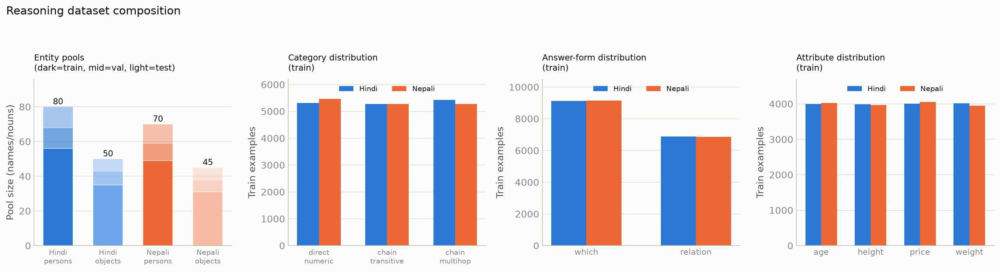

**Template variety**: 7 (category, form) groups × 4 phrasing variants = 28 distinct
full sentence structures per language, split disjoint 2/1/1 across train/val/test per
group (verified: zero overlap in any group, any split, either language).

### 1.5 Example renderings

| Category / form                 | Hindi                                                                                                                                                                    | Nepali                                                                                                                                                                 |
| ------------------------------- | ------------------------------------------------------------------------------------------------------------------------------------------------------------------------ | ---------------------------------------------------------------------------------------------------------------------------------------------------------------------- |
| `direct_numeric` / `which`      | विनोद का कद 196 सेंटीमीटर है, कृष्ण का कद 110 सेंटीमीटर है, और मीरा का कद 185 सेंटीमीटर है। इनमें से किसका कद सबसे कम है? → **कृष्ण**                                    | प्रियंकाको उमेर 79 वर्ष छ, अञ्जलीको उमेर 5 वर्ष छ, र मञ्जुको उमेर 42 वर्ष छ। यी तीनैमध्ये कसको उमेर सबैभन्दा कम छ? → **अञ्जली**                                        |
| `direct_numeric` / `relation`   | आम की कीमत 2063 रुपये है, जबकि मूली की कीमत 1495 रुपये है। क्या आम की कीमत मूली से ज़्यादा है, कम है, या बराबर है? → **ज़्यादा**                                         | गोलभेडाको मूल्य 2063 रुपैयाँ छ भने टेबलको मूल्य 1495 रुपैयाँ छ। के गोलभेडाको मूल्य टेबलको भन्दा बढी, कम वा बराबर छ? → **बढी**                                          |
| `chain_transitive` / `relation` | पंखा का वज़न नींबू से कम है। साथ ही, नींबू का वज़न साइकिल से ज़्यादा है। पंखा और साइकिल की तुलना करें तो पंखा का वज़न साइकिल से ज़्यादा है, कम है, या बराबर है? → **कम** | लसुनको तौल सिरानीको भन्दा कम छ। सिरानीको तौल टेबलको भन्दा बढी छ। लसुन र टेबलबीचको तुलना गर्दा लसुनको तौल टेबलको भन्दा बढी, कम वा बराबर छ? → **बढी**                    |
| `chain_multihop` / `which`      | विद्या का कद सावित्री से ज़्यादा है। सावित्री का कद मोहन से ज़्यादा है। मोहन का कद दीपक से कम है। इन चारों में से किसका कद सबसे कम है? → **मोहन**                        | प्याजको मूल्य पीठोको भन्दा कम छ। त्यस्तै, पीठोको मूल्य कागतीको भन्दा बढी छ। त्यस्तै, कागतीको मूल्य नुनको भन्दा कम छ। यी चारैमध्ये कसको मूल्य सबैभन्दा बढी छ? → **नुन** |

### 1.6 Correctness verification

Every generated example's gold answer was independently re-derived from the record's
own stored `values` array (not from the code path that produced it) and compared to the
stored `answer`: **0 mismatches across all 41,600 examples** (20,800 per language, all
splits). Entity-pool and template-id disjointness across splits was verified the same
way (programmatic set-intersection checks, zero overlaps found).

Output: `<lang>/reasoning/data/{train,val,test}.jsonl` + `<lang>/reasoning/data/stats.json`
(full counts, entity-pool sizes, template-variety listing, example records). Generator:
`scripts/reasoning/generate_reasoning_data.py`.

## 2. Finetuning protocol and hyperparameters

### 2.1 Protocol

Per the assignment's protocol requirements: each model starts from **its own** Phase 2
pretrained `best.pt` (Hindi iter 26,000, Nepali iter 25,000 — the lowest-val-loss
pretraining checkpoint, same ones used for Phase 2 evaluation), keeps that language's
tokenizer/vocabulary fixed (no retraining), and is finetuned **independently** — no
shared data, weights, or optimizer state between languages, matching the project's
Model H / Model L independence requirement throughout.

`scripts/training/finetune.py` (new, adapted from `train.py`): loads the pretrained
`GPTConfig`/weights via `checkpoint_utils.load_model`, then builds a **fresh** AdamW
optimizer (no carry-over of pretraining's optimizer momentum/variance — a new training
regime with a much lower learning rate) and trains with prompt-loss-masked supervised
finetuning (`scripts/training/finetune_dataset.py`): each example is packed as
`prompt_ids + answer_ids + [eos_id]`, right-padded to the batch's max length, with the
shifted target set to `-100` (the `F.cross_entropy` default `ignore_index` the
pretrained `model.py:164` already uses) at every prompt-token and pad position — so
only the answer+eos tokens contribute to the loss. No attention/padding-mask change to
`model.py` was needed: causal self-attention (`is_causal=True`) already guarantees a
real position never attends to anything after it, so trailing pad tokens can never
influence a real prediction.

### 2.2 Hyperparameters

| Hyperparameter        |                                                                                                                                                  Value |
| --------------------- | -----------------------------------------------------------------------------------------------------------------------------------------------------: |
| Base checkpoint       |                                                                                             Phase 2 `best.pt` (Hindi iter 26,000 / Nepali iter 25,000) |
| Train/val/test size   |                                                                                              16,000 / 2,400 / 2,400 examples per language (§1.4, §2.3) |
| Epochs                |                                                                                                                                                      8 |
| Batch size            | 32 (no gradient accumulation needed — reasoning prompts are ~20-90 tokens, far short of the 512-token block size that forced Phase 2's micro-batching) |
| Peak LR / min LR      |                                                                                                                                            3e-5 / 3e-6 |
| Warmup iters          |                                                                                                        50 (of 4,000 total: 500 iters/epoch × 8 epochs) |
| Weight decay          |                                                                                               0.1 (same GPT-style decay/no-decay split as pretraining) |
| Grad clip             |                                                                                                                                                    1.0 |
| Optimizer             |                                                                                         Fresh AdamW (β₁=0.9, β₂=0.95) — no carry-over from pretraining |
| Eval interval         |                                                      every 50 iters (full val-split pass + checkpoint check — see §2.3 for why this isn't epoch-based) |
| Checkpoint selection  |                                                                                `best.pt` = lowest full-val-split loss at any check (`last.pt` = final) |
| Precision             |                                                                                            `bfloat16` autocast (this run: local GPU with bf16 support) |
| Hardware / wall-clock |                                                                           ~2-3 min per language (4,000 iters), both run independently on one local GPU |

### 2.3 Two rounds of tuning, both driven by evidence: dataset size and checkpoint-check granularity

**Round 1 (4,000/600/600 examples, checked once per epoch):** the first finetuning pass
used a smaller dataset than §1.4's final 16,000/2,400/2,400. Validation loss
bottomed at **epoch 0** and rose for the rest of the 8-epoch schedule for both
languages, even as train loss kept falling — overfitting past the first epoch, on a
dataset this size. Exact-match accuracy was still a large improvement over the 0%
zero-shot baseline (Hindi 32.7%, Nepali 31.5%), but a closer look showed a real
mismatch: `last.pt` (the more "overfit" checkpoint by val loss) actually scored
**higher** than `best.pt` on exact-match overall, with `relation`-form accuracy
specifically much higher (Hindi 62.3% vs. 47.2%) while `which`-form was _worse_ (Hindi
15.5% vs. 22.1%) — evidence that cross-entropy loss and task accuracy were not tracking
the same thing at that dataset size.

**Round 2 (this report's final numbers): 4x more data, checked every 50 iters instead
of once per epoch.** Two changes were tried together, both motivated by round 1's
finding: (a) the dataset was regenerated at 16,000/2,400/2,400 examples (4x larger,
same generator, same held-out-entity/phrasing controls, §1), reasoning that `which`'s
weak "copy an entity name from context" skill might simply be under-exposed at 4,000
examples; (b) `finetune.py` gained an `--eval-interval` flag so the full-val-split
check (and `best.pt` save) happens every 50 iterations rather than only at epoch
boundaries — decoupling "how often we check" from "how many examples happen to fit in
one epoch," which matters a lot once the dataset (and therefore one epoch) is 4x
bigger. With the naive round-1 recipe simply re-run on the bigger dataset (still
checking once per epoch), `which`-form accuracy actually **collapsed** further (Hindi
4.3%, Nepali 4.0%) — because "epoch 0" on the bigger dataset now covers 4x more
gradient steps than round 1's "epoch 0," pushing straight past the true optimum before
the first check ever happened. Adding the 50-iteration check found that optimum
directly: **the true best validation loss for both languages occurs at iteration
~100** (of 4,000 total, still inside the 50-iteration warmup) — far earlier than any
epoch boundary would have found on its own.

The combined result (bigger dataset + finer-grained checking) beats round 1 outright,
not just its own naive-rerun:

|            | Hindi round 1 | Hindi round 2 | Nepali round 1 | Nepali round 2 |
| ---------- | ------------: | ------------: | -------------: | -------------: |
| Overall    |         32.7% |     **36.3%** |          31.5% |      **34.8%** |
| `which`    |         22.1% |         22.0% |          17.6% |      **23.2%** |
| `relation` |         47.2% |     **56.4%** |          51.2% |          50.0% |

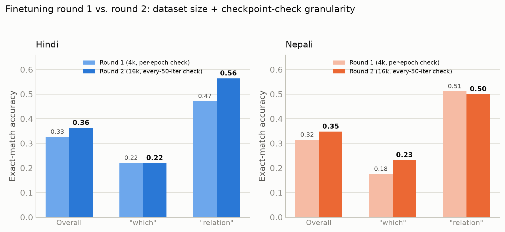

`which`-form recovers to at-or-above round 1's level (actually _better_ than round 1
for Nepali) while `relation`-form also improves for Hindi. **`best.pt` (lowest val
loss, now checked at 50-iteration granularity) is used as the reported "finetuned"
checkpoint throughout the rest of this report**, consistent with the val-loss-based
selection rule established in Phase 2 — the difference from round 1 is a
better-_found_ optimum under the same rule, not a different rule.

## 3. Reasoning evaluation: pretrained vs. finetuned

Run via `scripts/evaluation/reasoning_eval.py`: greedy-generate a short continuation
from each of the 2,400 reasoning test prompts, compare to the gold answer by exact
string match. Run against both the Phase 2 pretrained checkpoint (zero-shot baseline —
never saw this task's prompt/answer format at all) and the finetuned `best.pt` (§2.3's
round-2 checkpoint), both languages.

### 3.1 Overall accuracy

|                      | Hindi pretrained | Hindi finetuned | Nepali pretrained | Nepali finetuned |
| -------------------- | ---------------: | --------------: | ----------------: | ---------------: |
| **Overall accuracy** |         **0.0%** |       **36.3%** |          **0.0%** |        **34.8%** |

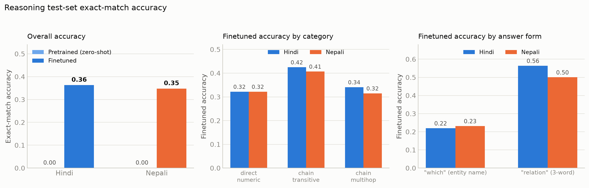

Zero-shot accuracy is exactly 0% for both languages — expected, since the pretrained
model was never trained to produce output in this fixed answer format (an entity name
or one of 3 relation words) at all, and greedy decoding from a general-purpose LM
essentially never happens to land on the exact right short string by chance. Both
languages land within 1.5 points of each other after finetuning (36.3% vs. 34.8%) —
close enough that it does not read as a real H-vs-L capability gap so much as the same
finetuning recipe producing a similar amount of task adaptation for both.

### 3.2 By category and answer form

|                           |     Hindi |    Nepali |
| ------------------------- | --------: | --------: |
| `direct_numeric`          |     32.2% |     32.2% |
| `chain_transitive`        |     42.5% |     40.7% |
| `chain_multihop`          |     34.1% |     31.5% |
| **`which` (entity name)** | **22.0%** | **23.2%** |
| **`relation` (3-word)**   | **56.4%** | **50.0%** |

(Both rows charted in the center/right panels of the figure in §3.1.)

The form split is the more informative one. **`relation`** (a fixed 3-word output:
more/less/equal) scores more than double **`which`** (must reproduce one of the
prompt's own — often held-out — entity names) for both languages. This is consistent
with the two forms actually being different kinds of task: `relation` is effectively a
3-way classification with a small, fixed, frequently-seen output vocabulary, while
`which` requires the model to correctly copy/select a specific token sequence (an
entity name) from its context — a strictly harder generation constraint, and one where
the held-out entity-name split (§1.2) means test-time names were never seen attached to
this task during finetuning at all.

`chain_transitive` scoring highest among the three categories (rather than lowest, as
"more hops = harder" might predict) is worth noting rather than smoothing over: with
only 3 entities, its relation-form question always asks about the same fixed pair
(positions 0 and 2 — see §1.1), which may make it an easier, more learnable pattern
than `direct_numeric`'s open-ended 2-or-3-entity numeric comparison or
`chain_multihop`'s randomly-chosen pair among 4 entities.

### 3.3 Qualitative examples

**Correct (Hindi, finetuned):**

> ज्योति का कद कमला से कम है। साथ ही, कमला का कद नेहा से ज़्यादा है। बताइए, इनमें से किसका कद सबसे कम है?
> **gold: ज्योति — predicted: ज्योति**

**Correct (Nepali, finetuned):**

> आरतीको उमेर 57 वर्ष छ भने गीताको उमेर 38 वर्ष छ। आरती र गीतामध्ये कसको उमेर बढी छ?
> **gold: आरती — predicted: आरती**

**Incorrect (Hindi, finetuned) — "which" picking a real-but-wrong entity from the prompt:**

> केला की कीमत थैला से कम है। साथ ही, थैला की कीमत तरबूज़ से ज़्यादा है। साथ ही, तरबूज़ की कीमत कुर्सी से कम है। बताइए, इन चारों में से किसकी कीमत सबसे ज़्यादा है?
> gold: थैला — predicted: **तरबूज़** _(a real entity in the prompt, but the wrong one)_

**Incorrect (Nepali, finetuned) — same failure mode, wrong-but-present entity:**

> सुन्तलाको तौल अनारको भन्दा बढी छ। त्यस्तै, अनारको तौल कापीको भन्दा कम छ। त्यस्तै, कापीको तौल झोलाको भन्दा बढी छ। भन्नुहोस्, यी चारैमध्ये कसको तौल सबैभन्दा कम छ?
> gold: अनार — predicted: **सुन्तला** _(also a real entity in the prompt, but the wrong one)_

Round 2's finetuned model (§2.3) mostly picks a real entity from the prompt rather than
hallucinating one absent from it entirely — a step up from round 1, where fabricating
an unrelated name was common in the `which`-form errors. The remaining error pattern is
now closer to "picked the wrong member of the given set" than "didn't use the context
at all," which is consistent with round 2's higher `which`-form accuracy (§3.2): more
training data and a better-selected checkpoint improved the copy-from-context skill
specifically, without fully solving it — `which` still trails `relation` by roughly 30
points for both languages.

## 4. Attention analysis: pretrained vs. finetuned

Reuses the Phase 2 attention toolkit (`attention_analysis.py`), extended with a
`--prompts-file` flag so a **fixed** set of 6 comparative-reasoning prompts (one per
category × form combination, drawn from each language's reasoning test set,
`<lang>/reasoning/attention_prompts.txt`) is fed to both the pretrained and the
finetuned checkpoint — identical input both times, so any difference in the resulting
heatmaps/entropy/distance is attributable to finetuning, not to different text.
Heatmaps are saved **one per head** (`attention_analysis.py`'s `plot_heatmaps`) rather
than all heads packed into one grid — a packed grid shrinks each head's token labels
to the point of being unreadable; a dedicated full-size figure per head keeps every
tick label legible. Full per-language/checkpoint/layer galleries (36 images each) are
in `<lang>/eval/attention_reasoning/{pretrained,finetuned}/`; the layer 10 (late)
gallery for Hindi — the layer §4.2 discusses in most depth — is shown below as an
example of the full per-head output.

**Hindi, layer 10 (late), pretrained — all 6 heads:**

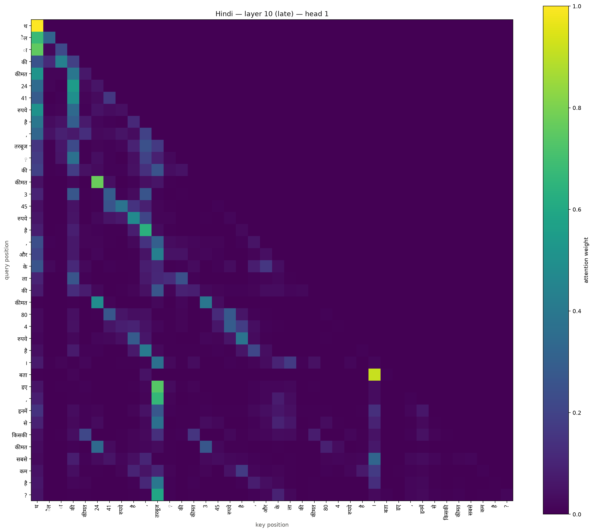
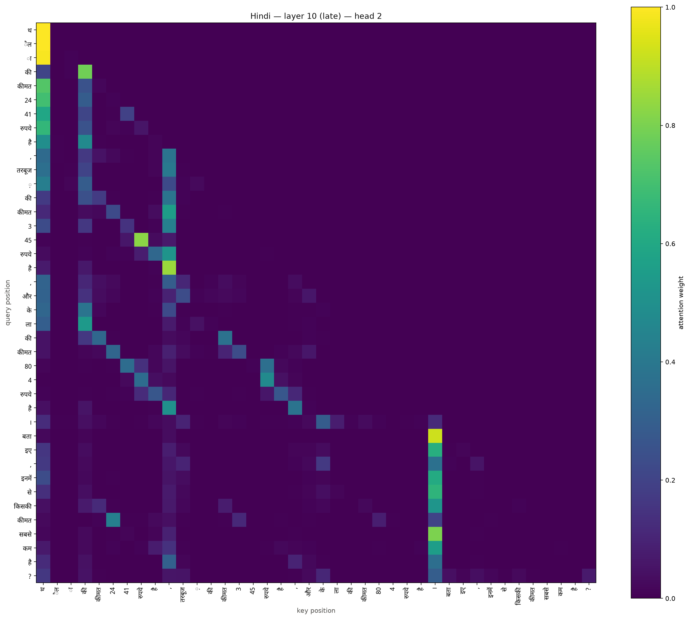
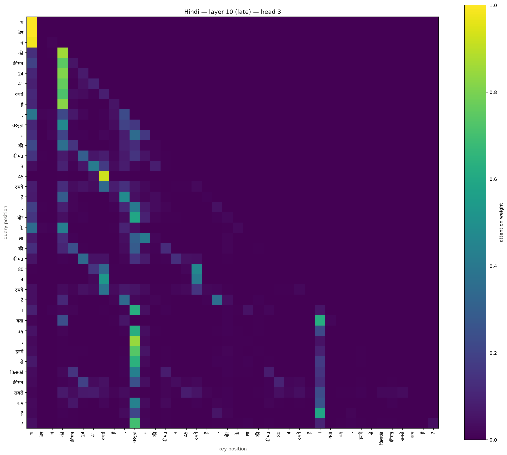
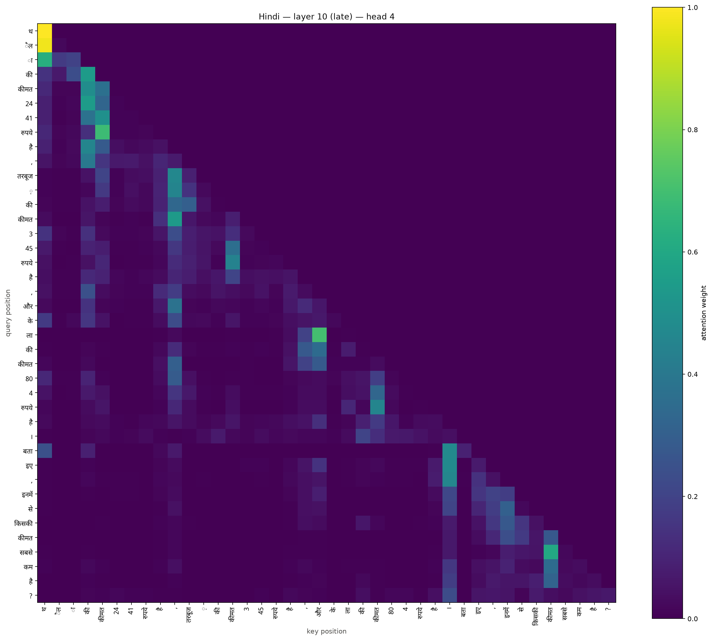
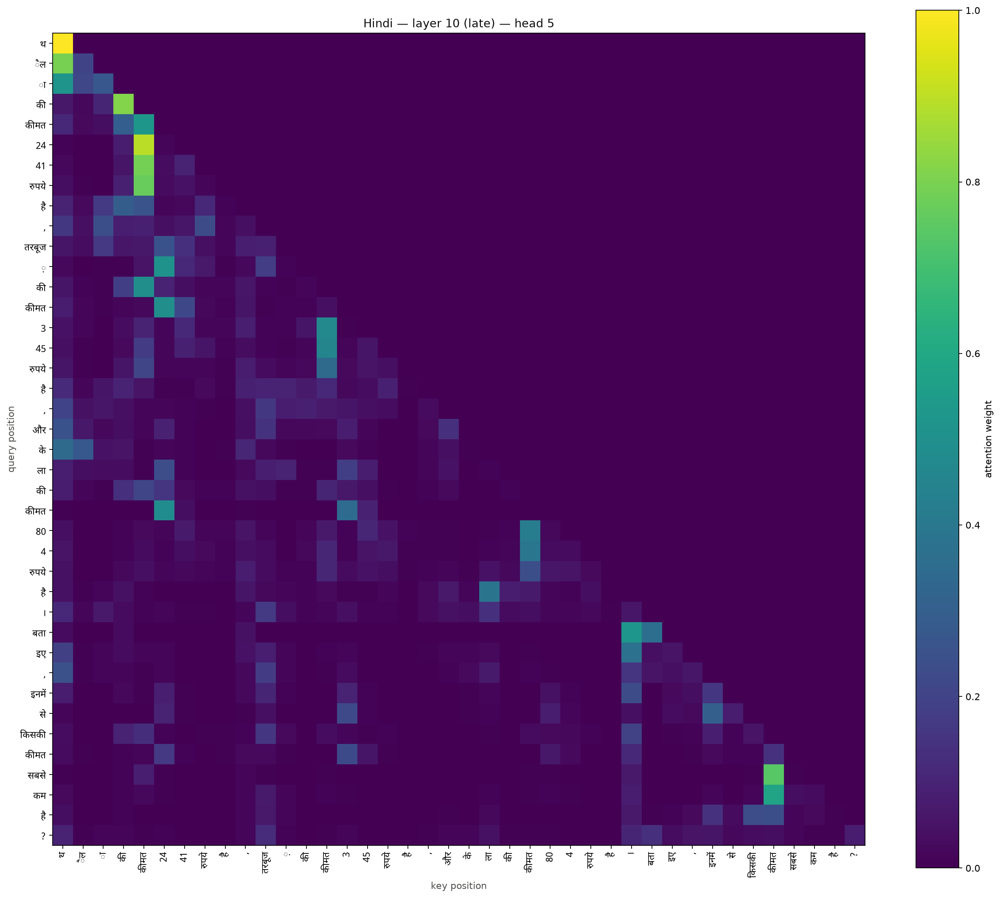

**Hindi, layer 10 (late), finetuned — all 6 heads (same prompt):**

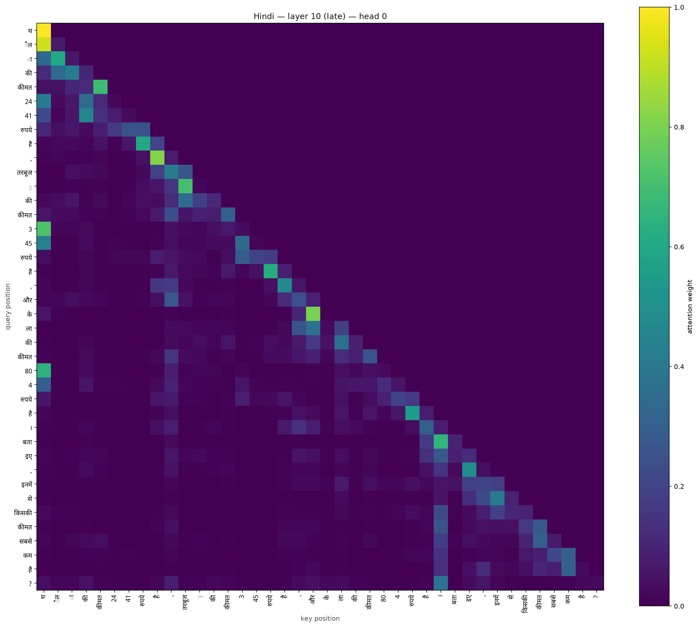
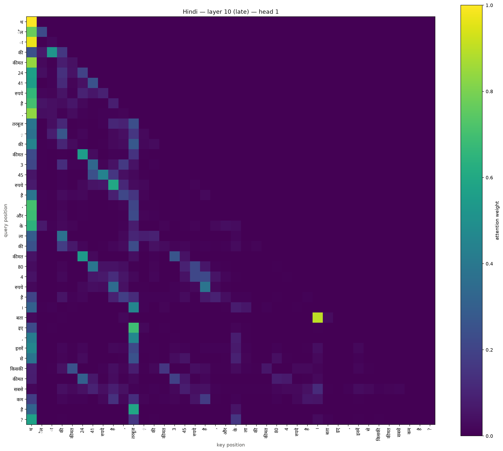
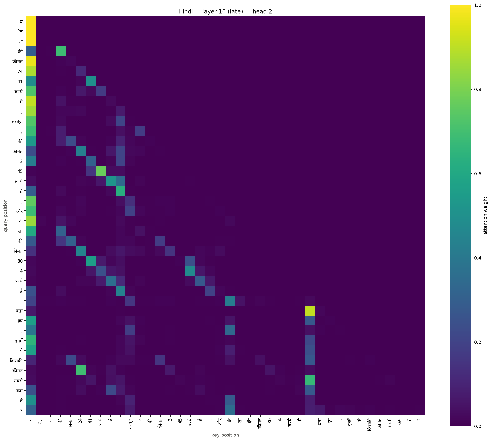
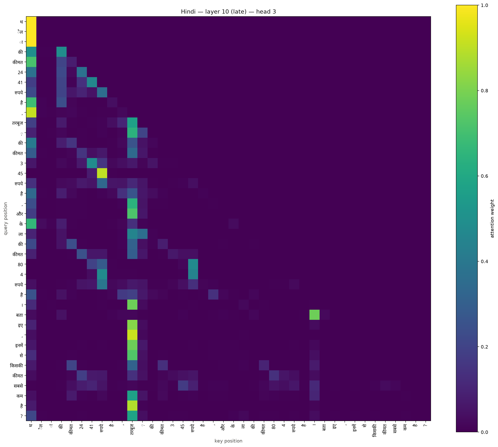
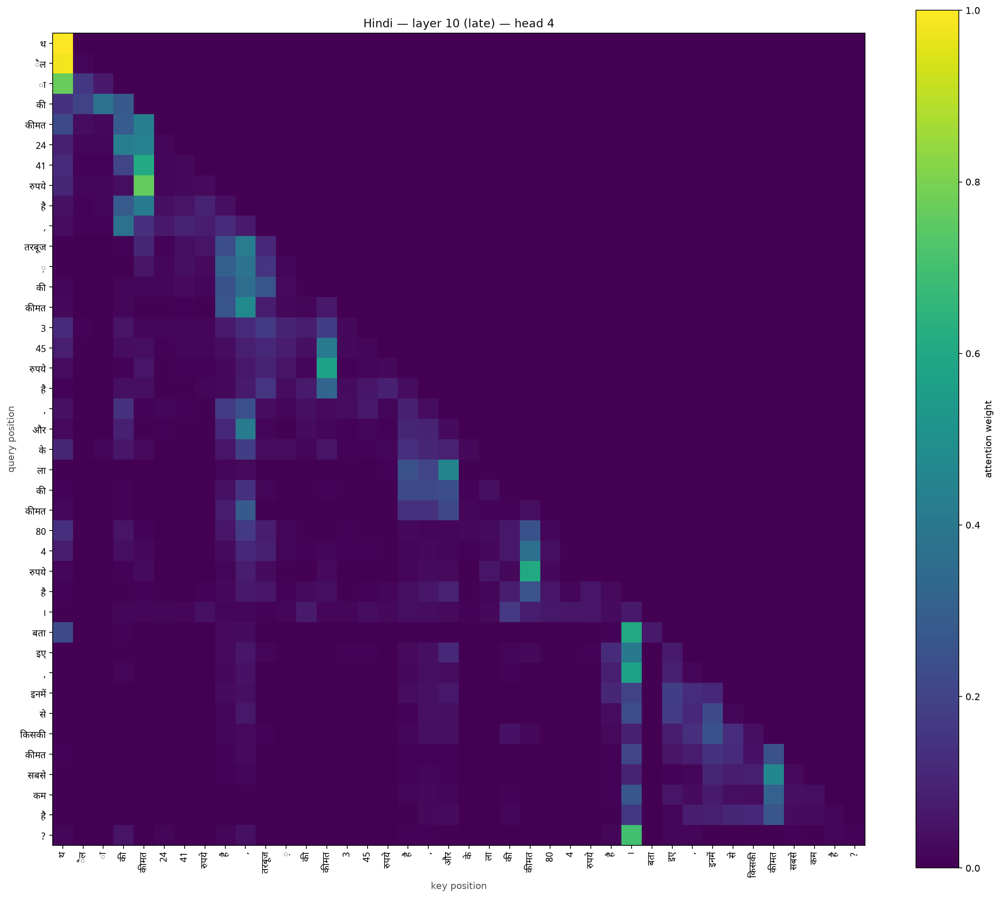
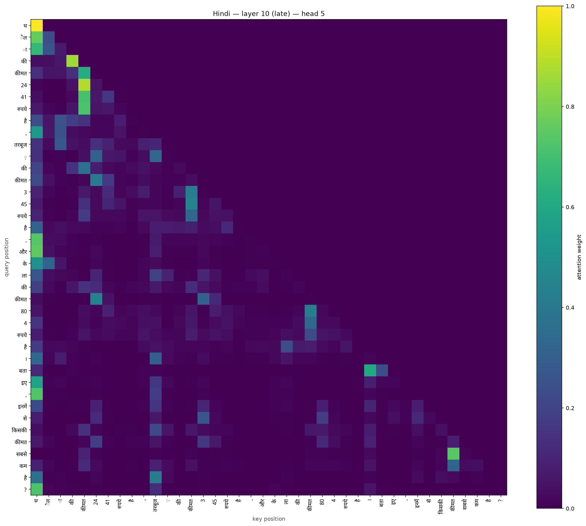

### 4.1 Entropy and mean attention distance, early vs. late layer

|                           | Hindi pretrained | Hindi finetuned | Nepali pretrained | Nepali finetuned |
| ------------------------- | ---------------: | --------------: | ----------------: | ---------------: |
| Entropy, early layer (0)  |            2.285 |           2.259 |             2.429 |            2.409 |
| Entropy, late layer (10)  |            1.665 |           1.555 |             1.655 |            1.829 |
| Distance, early layer (0) |             8.15 |            8.10 |              7.90 |             7.86 |
| Distance, late layer (10) |             9.75 |           10.60 |              8.42 |             7.27 |

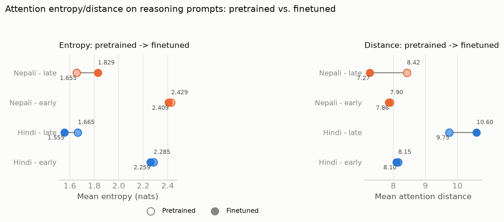

### 4.2 Discussion

The early-layer-diffuse/late-layer-focused pattern from Phase 2's general-text
attention analysis (report §7.3) **persists unchanged** on these comparative-reasoning
prompts, both before and after finetuning: entropy drops from early to late layer in
all four (language × checkpoint) combinations, consistent with early layers still
composing local/syntactic structure and late layers still integrating longer-range
context. Early-layer entropy/distance barely move after finetuning in either language
(≤0.03 nats, ≤0.05 tokens) — the early layers' role is essentially unchanged by
finetuning on this task.

The **late** layer is where finetuning leaves a visible mark, and the two languages
move in _opposite_ directions: Hindi's late-layer entropy **drops** further (1.665→
1.555, sharper/more committed attention) while its mean distance **increases** (9.75→
10.60, reaching further back); Nepali's late-layer entropy **rises** (1.655→1.829,
more diffuse) while its distance **decreases** (8.42→7.27, reaching less far). Both
patterns are internally consistent stories, just different ones: Hindi's shift reads as
the late layer becoming a more sharply-committed long-range lookup (plausibly useful
for pulling in a distant comparison target across a multi-hop chain), while Nepali's
reads as the late layer spreading attention more broadly nearby rather than reaching
far, which doesn't fit the same "reach back for the distant entity" story. Given round
2 (§2.3) still selects an early checkpoint (iter ~100 of a 4,000-iter schedule) and
each language's finetuned model came from an independent training run with its own
correct-vs-hallucinated-entity error profile (§3.3), a diverging outcome between
languages is plausible rather than an anomaly — but it does mean this analysis
supports a "finetuning changes the late layer, direction depends on the language/run"
statement, not a single universal direction. A longer or larger-scale reasoning
finetune, or averaging over multiple finetuning seeds per language, would be needed
before a stronger, single-direction claim about head specialization could be supported
by this evidence.

## 5. Final consolidated report

### 5.1 How did data scale and quality differ between Model H and Model L?

Hindi had a substantially larger, more diverse manual-collection base (7 working
sources, 199,988 articles, dominated by one deep date-archive) versus Nepali's 4
working sources (313,872 articles, but concentrated in 2 large outlets — khabarhub and
nepalpress alone are 76% of Nepali's manual corpus; Phase 1 report §4.4). Nepali's own
near-duplicate rate at the final MinHash pass was **8x** Hindi's (4.58% vs. 0.55%,
Phase 1 report §5.7) — direct, measured evidence of a smaller, more repetitive
source pool for the lower-resource language, exactly the kind of quality gap "higher
resource vs. lower resource" is meant to capture, independent of the final token counts
(which landed within 1% of each other, ~510M each, after the preprocessing cap).

### 5.2 How do LM and reasoning results compare across the two resource tiers?

|                                          | Hindi (H) | Nepali (L) |
| ---------------------------------------- | --------: | ---------: |
| Test perplexity (Phase 2)                |     27.32 |      45.21 |
| Test BPB (Phase 2)                       |    0.4435 |     0.4333 |
| Reasoning accuracy, pretrained (Phase 3) |      0.0% |       0.0% |
| Reasoning accuracy, finetuned (Phase 3)  |     36.3% |      34.8% |

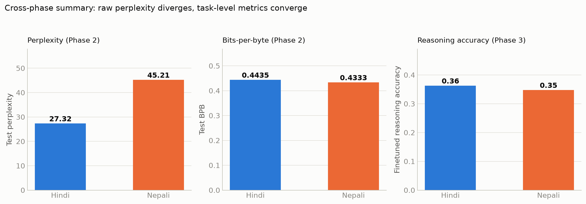

The pattern is consistent across both phases: **the tokenizer-normalized/task-level
numbers are close between H and L, while the raw/token-level number (perplexity) is
not.** Phase 2 already showed most of the 66%-relative perplexity gap is a tokenizer-
fertility artifact, not a real pretraining-quality gap, once BPB (which cancels out
fertility) shows the two models essentially tied. Phase 3 reinforces the same
direction: reasoning finetuning — which operates on the model's actual comparison/
inference ability, not on raw next-token perplexity — produces nearly identical
outcomes for both languages (36.3% vs. 34.8%, a 1.5-point gap, closer than BPB's own
0.0102-point gap suggests in relative terms). Taken together, the two phases point the
same way: Model H and Model L are much more comparable in what they actually learned
than a first glance at perplexity alone would suggest.

### 5.3 What tokenizer/corpus factors most affected the low-resource model?

**Tokenizer fertility** is the most quantifiable, directly-measured factor: at the
shared 16k vocabulary, Nepali fertility is 1.348 tokens/word vs. Hindi's 1.210 (Phase 1
report §6.3) — Nepali words fragment into more subword pieces, which by itself
explains most of the raw perplexity gap (§5.2 above) without implying worse learning.
**Corpus near-duplication** is the other measured factor: Nepali's manual corpus, drawn
from fewer, more concentrated outlets that frequently cover the same news events,
carried an 8x higher near-duplicate rate than Hindi's after full corpus-wide MinHash
dedup (§5.1) — meaning a larger share of Nepali's _raw_ collected pool was redundant
content before any of the token-budget accounting in Phase 1 even applied. Both factors
trace back to the same root cause named throughout Phase 1: Nepali simply has a
smaller, more concentrated real-world publishing ecosystem to draw from than Hindi,
independent of anything about the modeling or finetuning pipeline itself.

### 5.4 What evidence explains the observed differences?

Every gap this project actually measured between Model H and Model L is traceable to
the data-availability difference in §5.1/§5.3, not to the architecture (identical for
both models by design), the training procedure (identical hyperparameters/schedule
shape for both), or the reasoning task (the same synthetic generator, template design,
and finetuning recipe for both). Where a metric is sensitive to tokenizer fertility
(raw perplexity) or corpus redundancy (fertility itself, indirectly, since a more
repetitive corpus trains a less efficient subword vocabulary at a fixed vocab size),
Nepali reads worse. Where a metric normalizes past those factors — BPB in Phase 2,
exact-match reasoning accuracy in Phase 3 — Hindi and Nepali land within a couple of
percentage points of each other. The overall conclusion this project's evidence
supports: **the gap between a higher- and lower-resource Indian language, at this model
scale and this style of finetuning task, is substantially a data/corpus-availability
gap, not a gap in what an identically-sized, identically-trained model is capable of
learning from whatever data it does get.**
